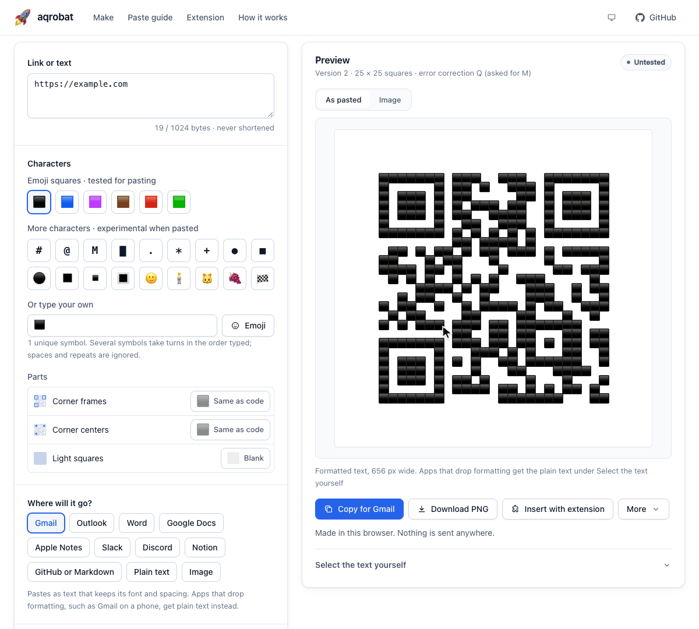

#  Aqrobat

<picture>
  <source media="(prefers-reduced-motion: reduce)" srcset="docs/demo/aqrobat.png">
  
</picture>

[Open Aqrobat](https://ryanjosephkamp.github.io/aqrobat/) ·
[Chrome extension](https://ryanjosephkamp.github.io/aqrobat/downloads/aqrobat-extension.zip) ·
[Offline page](https://ryanjosephkamp.github.io/aqrobat/downloads/aqrobat-offline.html) ·
[Command line](#command-line-and-api)

**QR codes, in character.** Aqrobat makes working QR codes drawn with real
text characters and emoji, then shapes the copy for the place you paste it: an
email, a document, a chat, or a code block. It is free, runs in your browser,
sends nothing anywhere, and needs no account.

## What it does

1. **Type a link or some text,** up to 1024 bytes. It is never shortened; input
   that does not fit is refused.
2. **Pick the characters** that draw the dark squares: emoji squares in six
   colors, `#`, `@`, `█`, other emoji, or your own mix.
3. **Pick where the code will go.** The preview shows exactly what will be
   pasted, and the main button copies it in that shape, always in your
   characters.

Every dark square of a standard QR code becomes a character and every light
square a blank (or a white emoji in emoji text), so the code is text you can
select, not a picture. Nothing is
hidden behind the characters.

## Where it pastes

Apps treat pasted text differently, so each destination gets its own format.
Every format carries the characters you picked.

| Destination                                          | Pastes as       | Tested characters |
| ---------------------------------------------------- | --------------- | ----------------- |
| Gmail, Outlook, Word                                 | Formatted text  | Emoji squares     |
| Google Docs, Apple Notes, Slack, Discord, plain text | Plain text      | Emoji squares     |
| GitHub, Markdown                                     | Code block      | Full blocks       |
| Notion                                               | Code-block text | Full blocks       |
| Anywhere else                                        | Image           | Any               |

**Emoji squares** (⬛ and ⬜, with the dark square in six colors) line up in
any font, because every emoji in a font is the same width. **Full blocks**
(`█`) keep their shape in a monospace code block. Other characters paste as
chosen: other emoji get ▫️ in the light squares and ⬛ corners, which helps a
camera find them, and letters line up only in a monospace font. Grape and
black-heart codes laid out this way have scanned after pasting into Gmail on a
phone. The page marks these choices experimental, warns about emoji too light
to scan, and switches to the tested choice in one tap. Gmail on a phone closes
up spaces, so letters need a computer or an image there; see
[paste formats](docs/text-portability.md#gmail). Formatted text also carries
the same characters as plain text, for apps that drop formatting, such as
Gmail on a phone.

**Parts** give the corner markers' frames, their centers, and the light squares
characters of their own, in the image and every paste: turn the black corners
off, color them with 🟥 or 🟦, or fill the light squares with 🤍. The page warns
when a part is likely to stop a camera from reading the code. On a computer
without an emoji keyboard, the **Emoji** button opens a picker that searches
emoji by name and keyword, as phone keyboards do.

Every new code starts **Untested**: fonts, line spacing, screens, and phones
vary, so scan the pasted result before you rely on it. The **Scan lab** on the
page builds each paste format in typical app fonts and records what your phone
reads.

Other exports: PNG, SVG, plain text, RTF, an HTML page of the text, a printable
sheet, and a recipe file that rebuilds the same code anywhere.

## Chrome extension

The extension inserts a code straight into the field you are writing in. It
measures that field's own font, so the code keeps its shape without the
clipboard.

- **One click:** choose Aqrobat in the toolbar to make a code for the current
  page, then copy it for the destination it detects, or insert it on the page.
- **Right-click** a selection, a link, or the page to open it in the workbench.
- **Saved codes:** keep up to 20 and insert any of them later.
- **Inserts safely:** pick the field, preview, then insert. Your draft is kept,
  selected text is never replaced, and Undo removes the code.

To install:

1. Download and unzip
   [the extension](https://ryanjosephkamp.github.io/aqrobat/downloads/aqrobat-extension.zip).
2. Open `chrome://extensions` and turn on **Developer mode**.
3. Choose **Load unpacked** and pick the unzipped folder.

Try insertion first on the
[practice page](https://ryanjosephkamp.github.io/aqrobat/downloads/aqrobat-insertion-practice.html),
which needs no install. The extension asks only for `activeTab`, `scripting`,
`storage`, and `contextMenus`, so it can reach a page only after you click it
there. [More about insertion](docs/browser-insertion.md).

## Command line and API

The page, the extension, and a Node 22+ command-line tool share one core with
no runtime dependencies.

```sh
node bin/aqrobat.mjs 'https://example.com' --format tiles
node bin/aqrobat.mjs 'https://example.com' --format markdown
node bin/aqrobat.mjs 'https://example.com' --glyph '#' --density 2x1 --format recipe --out qr.json
node bin/aqrobat.mjs --recipe qr.json --format svg --out qr.svg
```

```js
import { generate } from "./src/core.mjs";
import { tileText } from "./src/portable.mjs";

const qr = generate("https://example.com");
console.log(tileText(qr).text);
```

Output files are never overwritten. See the
[command-line guide](docs/command-line.md) for every option.

## How it works

A standard encoder (Project Nayuki's, MIT licensed) turns your exact input into
a normal QR matrix. Aqrobat then draws that matrix with characters, measuring
fonts so the squares stay square. Codes come out the same way every time, with
no server and no AI involved.

More detail: [how it works](docs/how-it-works.md) and
[paste formats](docs/text-portability.md).

## Prose QR research

A side project asks whether readable, copyable prose can also be a QR code.
Prose scanned on a phone when each letter was set in one of two tones, but
nothing that looked like ordinary prose scanned. Read the
[research notes](https://ryanjosephkamp.github.io/aqrobat/research/).

## Development

```sh
npm ci
npm test
npm run build
npm run test:browser
npm run test:text-browser
npm run test:insertion
npm run format:check
npm run serve
```

Browser checks use installed Chrome on macOS, or set `CHROME_PATH`.
`npm run test:extension` loads the built extension in a fresh profile. Branded
Chrome no longer loads unpacked extensions from the command line, so point
`EXTENSION_CHROME_PATH` at Chrome for Testing. The build replaces only
`dist/extension/` and the three files in `downloads/`.
`node tools/demo.mjs` records the demo above from the real page (it needs
ffmpeg). `node tools/emoji-data.mjs` rebuilds the emoji picker's list from
Unicode's data. `node tools/gmail-sim/run.mjs` checks codes against a
[model of Gmail](tools/gmail-sim/README.md) calibrated on real phone scans.

## License

MIT. The bundled QR encoder keeps its own MIT notice, the emoji picker's list
keeps Unicode's license, and system emoji fonts keep their own licenses. See [LICENSE](LICENSE) and [NOTICE.md](NOTICE.md).
